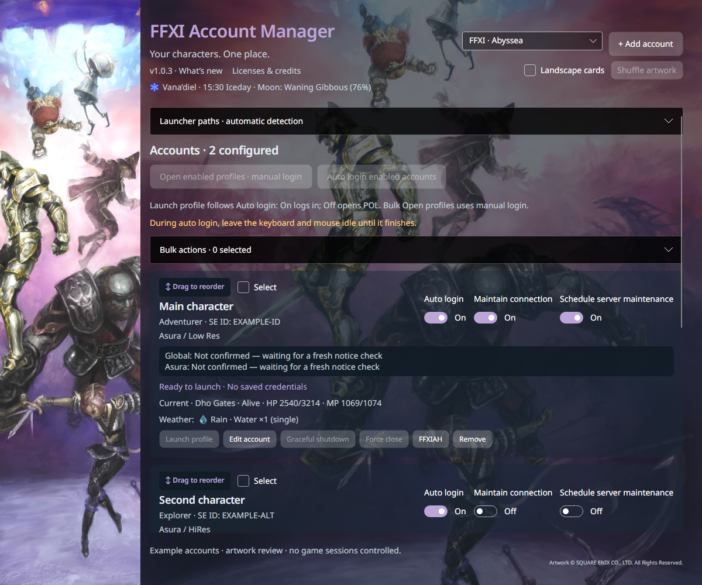
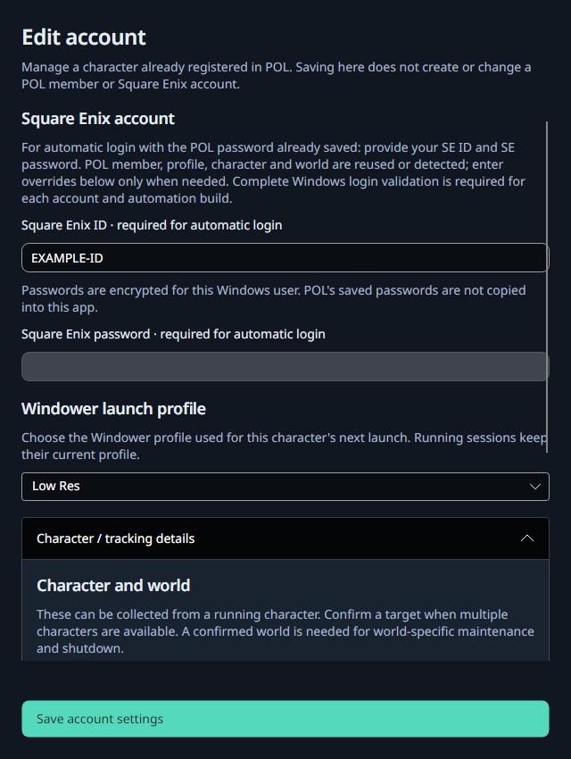
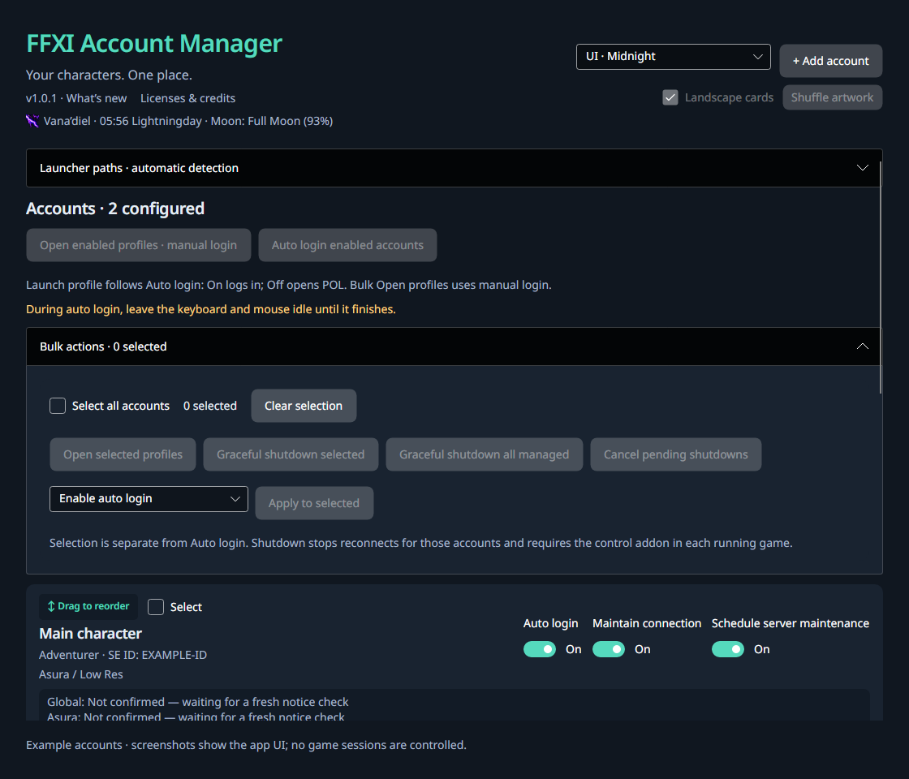

# FFXI Account Manager

Windows-first account management and launch automation for Windower and Final Fantasy XI, built with Avalonia and .NET 10. Shared UI and core code support a future Linux/SteamDeck adapter.

## App walkthrough

These screenshots show the actual application UI with example accounts and no saved passwords. Captured in the cross-platform renderer; Windows-only launch controls are disabled in these examples.

POL auto login defaults to a native 640 × 480 client window. Toggle this under Launcher paths to retain another POL size; FFXI still uses the selected Windower profile resolution. After exact member selection, the app replays the trained POL control path and only types credentials once the password editor is ready.

### Account dashboard and themes



Choose one of four dark UI themes or 12 artwork themes, including Abyssea. Expanded windows show a tall cropped art panel with a background behind the accounts; Amano · Autumn, Abyssea, Promyvion, and Original FFXI pair two different images. Disable Landscape cards for more translucent account cards; enable it for prominent landscape images with minimal shading. Shuffle uses every image before repeating and avoids duplicate visible cards while enough images are available. Images keep their aspect ratio. Drag the handle on each card to reorder accounts. **Auto login** controls whether a character's Launch profile button completes login. While auto login runs, its button pulses and becomes **Stop auto logins**. Click it to cancel the queue and active input while keeping POL and games open. Cancelled accounts remain paused for recovery until explicitly launched again. **Maintain connection** enables recovery; **Schedule server maintenance** plans downtime around applicable notices.

World Map, Zilart and Blue Illustration use a continuous panoramic background: the left panel reveals the adjoining artwork rather than repeating it.

[See every theme at full size](docs/themes/README.md), including the narrow-window Abyssea view.

### Configure an account



Provide the SE ID and password, choose a Windower profile, and confirm character/world details. Already-saved POL credentials are reused; the app does not create a Square Enix account or POL member.

### Bulk controls



Select cards, then expand **Bulk actions** to apply settings or request graceful shutdown. Selection is independent of Auto login. Load the companion addon in running characters before using IPC shutdown controls.

## Features

- Configure accounts with encrypted credentials, named Windower profiles, and separate Auto login, Maintain connection and maintenance scheduling switches.
- Launch profiles individually or in batches. Per-account **Launch profile** follows the Auto login switch; bulk **Open profiles** controls leave login to you.
- Discover and attach existing character sessions using process ownership and companion-addon character/world reports.
- Complete POL and FFXI login with learned action paths, exact-character verification and guarded input. Keep keyboard and mouse idle during foreground login automation.
- Recover brief focus loss during login screen capture with a bounded retry budget and process verification.
- With **Maintain connection** enabled, detect confirmed disconnect dialogs even while POL is still running, try character selection, and restart the affected session when another error prevents reconnection.
- Gracefully shut down individual or grouped sessions, cancel pending shutdowns, and clean up disconnected POL processes. Explicit Force close is available for attached hung sessions.
- Track official global/world maintenance notices in your local time zone, schedule downtime and pause reconnection attempts during maintenance. The companion also observes in-game emergency warnings. In **Server maintenance**, choose whether to show card alerts and set one global 0–168-hour advance-notice threshold (default 12; 0 shows active maintenance only). Every account uses that threshold for its applicable notices. Matching-world notices take precedence over global notices; the main section retains the full schedule and in-game alerts. These display preferences do not change scheduling or reconnect protection.
- Choose saved UI/artwork themes, landscape account cards, and drag-to-reorder account order.
- Show current jobs and levels in the form **ML 46 99DRK/57WAR**, with last-observed jobs retained offline.
- Show shared Vana’diel time, weekday element and moon phase; display per-character zone weather with single/double element icons.

Character stats, jobs and weather report once per minute. Master level comes from cached/passively observed server-stat packets; an unavailable master level is displayed as unknown. Session health heartbeats and IPC command checks remain separate, and logout is reported immediately. Offline cards retain their last observation rather than claiming current weather.

## Downloads and requirements

Download the Windows x64 ZIP from [GitHub Releases](https://github.com/zipkindev/ffxi-account-manager/releases/latest). Build artifacts are also available from GitHub Actions (sign-in may be required). The standalone `.exe` needs no ZIP extraction or separate .NET installation. A folder ZIP is also available; extract its entire contents before launching it. The self-contained build does not require a separate .NET installation.

The latest **1.0.27** fix prevents unnecessary focus changes during quiet, healthy connections. Windows folder packages and standalone executables are built by the [main build workflow](https://github.com/zipkindev/ffxi-account-manager/actions/workflows/build.yml?query=branch%3Amain).

You need Windows x64, an existing working Windower/PlayOnline/FFXI installation, and configured POL members. This app does not include the game, Windower or a subscription.

## Windows setup

Run the standalone executable directly, or keep all files together if using the folder ZIP. The standalone app automatically materializes its OCR, installer, addon and license support files under `%LOCALAPPDATA%\FFXILauncher\app-payload`, while .NET extracts bundled native libraries into its Windows cache. The protected Windows installation creates a scheduled-task launch shortcut; setup requires administrator consent, while routine launches use the installed task.

Windower and POL paths are detected automatically, with manual overrides in **Launcher paths**. Configure the SE ID and password; character/world and member mapping must be resolved before complete automated login. POL/local member passwords are conditional on your existing POL configuration. Unattended OTP login is not supported.

Select **Deploy addon + enable auto-load** to install FFXIManager and add its startup entry to Windower's `scripts/init.txt`. Existing script commands and addon data are preserved. For already-running games, enter:

```text
//lua load FFXIManager
```

After an addon update, use `//lua reload FFXIManager` in each running game. Future sessions load it automatically. Closing the manager leaves games running.

Account metadata is saved under `%LOCALAPPDATA%\FFXILauncher\accounts.json`, and passwords under `vault/`, encrypted with Windows DPAPI for the current Windows user. Do not commit local account data, vaults or addon control files. These paths and local build/agent artifacts are excluded by `.gitignore`.

## Connection recovery

Enable **Auto login** and **Maintain connection** for each account you want recovered, complete its Windows login validation, and leave the manager open. The companion addon must be loaded for server-traffic reporting. Reload it after an update using `//lua reload FFXIManager`; fresh game launches load the updated addon automatically.

Screen checks follow connection evidence. In **1.0.27**, connection reports are published and checked **every 30 seconds**; stats stay on their **60-second** cadence. The first two missed or unhealthy checks leave the window alone. **The third consecutive failure** permits a fresh report recheck and OCR; any healthy, advancing report resets the failure count. Current reports tolerate quiet packet intervals of up to 90 seconds, so the observed healthy 61-second gap does not trigger OCR. A single missing heartbeat or brief file-read gap also does not qualify. If no disconnect dialog is found, further checks wait five minutes while the same condition persists; fresh traffic resets that delay. Activity explains why an inspection ran and what it found.

The addon passively observes existing incoming packets; packet events only update in-memory timestamps/counters until the next connection report. The manager reads local status files without requesting extra server traffic. The existing rendering heartbeat and command acknowledgements remain separate for login/shutdown controls, because an error screen can keep rendering after the connection has failed. Injected packets do not count as server activity. An original server packet still counts as received if another addon blocks its game processing. Missing or stale traffic alone never authorizes force close.

Recovery requires two matching reads of **FFXI-4001**, **FFXI-4002** or **POL-0250**, with the corresponding disconnect wording verified before pressing OK. It acknowledges the initial dialog and resumes the recognized game screen. In **1.0.28**, reaching character selection continues through the existing account-bound character confirmation cache and into the world in the same process. Character selection does not authorize force close. Recovered world entry requires fresh matching server traffic as well as the character/world heartbeat; a still-rendering menu cannot count as success. If a further confirmed error prevents reconnection, it closes only that account's tracked process and queues a fresh login. If acknowledging the disconnect makes POL exit itself, it queues a fresh login without another close request. Restart verifies process identity, and successful login verifies the configured character and world.

Readiness requires enabled recovery switches, usable saved credentials, a resolved Windower profile, a matching previously validated account mapping, and a correctly tracked process with the companion addon loaded. Confirmed-disconnect recovery may use that matching prior validation after an app update and establish a new full-login proof if a fresh restart is needed. Starting in **1.0.29**, complete-login validation follows the login implementation rather than the app version or assembly build. Updates that leave the fingerprinted login sources and account mapping unchanged preserve validation, including for ordinary startup and process-exit recovery. Changes to login sources or the account mapping require a new complete login. The reviewed legacy builds used by the current accounts carry their existing proofs forward; unknown legacy builds require validation.

Starting in **1.0.32**, specific disconnect messages can still be recognized when an addon panel obscures the “Error code” caption: the actual numeric code and matching failure wording must remain readable. FFXI-3100 joins the confirmed disconnect recovery route. POL-0019 version-service failures use the existing window's explicit Retry button after 30, 60 and 120 seconds, with two matching reads before acting. Changed screens and exhausted retries leave the window open. Known agreement/title/character menus are confirmed twice and resumed in the tracked process. An obscuring HaupBridge panel can be closed through its fixed local menu command only after verifying the configured Insert console key and empty console prompt; automation settings remain intact. A twice-confirmed **POL-1039** other-terminal login disables Maintain connection for that character, acknowledges OK and exits only its local POL process. Its card retains the error code and reason across restarts; re-enable Maintain connection after ending the other login. Manual Launch profile offers a **Launch anyway** warning and can override the pause while Maintain connection stays off. FFXI-3201 remains a separate timed held-session retry. The report cadence and three-missed-check OCR threshold remain unchanged. Recent dashboard messages are retained in rotating `diagnostics/activity.jsonl` files for troubleshooting.

After an unexpected process exit, **1.0.31** waits two minutes before automatic restart. This gives the server time to clear the old character session. If FFXI returns **3201: Same character is already logged in**, the manager confirms the specific dialog, waits one minute, confirms it again and retries character entry in the same process, up to five times. It does not close this dialog as a fatal crash or resubmit POL credentials. The exact server expiry is not assumed; the delay is a recovery policy with a bounded fallback.

Known game maintenance pauses recovery. Support-center-only notices do not block game reconnection. Credential rejection, intentional shutdown, cancellation and disabling Maintain connection stop the applicable recovery actions. A hung window has a separate cleanup threshold: at least 90 continuous seconds without a rendering heartbeat or recent server traffic. Idle cards show **No process tracked**, with shutdown controls disabled when no process is running.

Live testing verified the FFXI-4001/4002 → POL-0250 → fresh-login path on two accounts; all four test accounts ultimately had responsive sessions and fresh server traffic. A separate Mini-only trial on 1.0.28 verified automatic FFXI-4001 recovery through cached character confirmation and world entry in the same process, with the other three accounts preserved. Mini-only 1.0.31 trials also verified an early reconnect through FFXI-3201 with a one-minute retry in the same process, and normal automatic crash recovery after the two-minute delay without that error; the other three sessions stayed unchanged. The hang-timeout path still needs a separate live trial. See [Windows troubleshooting](docs/WINDOWS-TROUBLESHOOTING.md#running-process-disconnect-recovery-1026) for validation scope and diagnostics.

## Game updates after maintenance

Version **1.0.30** prepares an updater branch in full automatic login. After maintenance ends, the existing startup queue can launch POL, recognize an explicit Version Update screen, choose its uniquely identified Update/Next control, handle a specific update confirmation, wait through file checking/download/install, acknowledge explicit completion, and continue through the normal login route to verified character/world entry. Screens are checked twice before an updater control is clicked; the updater never sends a blind Enter or chooses file repair.

Only one updater runs at a time; an unfinished updater retains ownership across automation timeouts so another account cannot begin patching the same files. Other live or ambiguous game windows using the same POL installation block updater input so the shared game files are not patched while those sessions run. Prepared startup POL windows may queue behind it. Progress is inspected every five seconds during the active update, with a two-hour limit and a 15-minute no-progress stop; healthy in-game connection checks remain every 30 seconds. Error, unknown or restart-required screens retain POL for inspection. A POL or Windows restart is not automated yet.

**Validation status:** offline workflow tests and native checks prepare the route; they do not prove the current live updater layouts. At the next maintenance, use Mini as the first account, let other game sessions exit, record the real updater transitions and completion, verify fresh world traffic, and only then test Mini crash recovery. Do not count a no-update login as a successful update trial. See [the updater trial checklist](docs/WINDOWS-TROUBLESHOOTING.md#updater-preparation-1030).

## Versioning and releases

`Version.props` is the single application version source. Click the version beneath the app title for bundled [release notes](CHANGELOG.md), including major updates and validation scope.

For the next release:

1. Update the major.minor.patch version in `Version.props`.
2. Add the matching section to `CHANGELOG.md`.
3. Run `python tools/check-release.py` and the checks below.
4. Use the matching Git tag `vX.Y.Z`. GitHub CI rejects a tag that differs from the app version or missing release notes.

CI builds and validates the Windows package and runs isolated Lua addon checks. It uploads build artifacts; it does not automatically publish a GitHub Release.

## Build and validation

Install .NET 10 SDK, then run:

```sh
dotnet build FFXILauncher.sln
dotnet run --project tests/FFXILauncher.Core.Tests
dotnet run --project tests/FFXILauncher.Desktop.Smoke
python tools/check-release.py
```

Publish a self-contained Windows build with PowerShell:

```powershell
./tools/publish-windows.ps1
# Compressed standalone executable:
./tools/publish-standalone.ps1
```

Test the companion with Lua and an isolated temporary directory:

```sh
mkdir -p /tmp/ffxi-manager-addon-test/data
lua tests/test_manager_addon.lua /tmp/ffxi-manager-addon-test/
```

Automated checks cover configuration, identity, maintenance policies, disconnect recognition and recovery guards, server-traffic freshness, IPC authentication/session binding, UI behavior and credential handling. Complete successful Windows login records account/profile/login-flow validation; unattended recovery and scheduled downtime depend on that proof. Confirmed disconnects follow the recovery flow above; credential rejection pauses retries. Live shutdown-cancellation testing remains outstanding. Linux/SteamDeck launch automation and reliable extraction of saved POL account identities remain planned.

If POL closes before its login screen, run this from the repository in Windows PowerShell, then try the usual launch during the 60-second observation:

```powershell
powershell -NoProfile -ExecutionPolicy Bypass -File .\tools\windows-crash-report.ps1
```

The JSON report under `%LOCALAPPDATA%\FFXILauncher\diagnostics` includes recent matching Windows Application Error, Windows Error Reporting, .NET Runtime exception and hang events, configured executable versions, local graphics-wrapper versions/hashes, and process/window observations. It also lists existing crash dump files without reading them. Use `-WatchSeconds 0` to collect only the current process snapshot and recent events. The script does not launch or change POL, collect credentials, or take screenshots. Paths and Windows event fields can contain local user information. No matching event does not rule out a crash; collection failures are listed separately. See [Windows troubleshooting](docs/WINDOWS-TROUBLESHOOTING.md) for the existing single-account test workflow and the graphics-wrapper investigation.

Artwork and icon provenance is listed in `src/FFXILauncher.Desktop/Assets/Themes/SOURCES.md` and `Assets/Weather/SOURCES.md`. See [implementation details](docs/IMPLEMENTATION.md) for architecture and remaining work.

## License and distribution

Original code and documentation are licensed under [MIT](LICENSE), copyright 2026 zipkindev and contributors. Keep the license and copyright notice with redistributed copies.

FFXI artwork, game icons and trademarks are excluded from MIT and remain subject to their owners’ terms. Read [the artwork notice](ARTWORK-NOTICE.md) before distributing artwork-inclusive builds: the linked Square Enix policy does not explicitly address desktop bundling. MIT does not grant commercial rights to those assets. This project is independent and is not endorsed by Square Enix.

Dependencies retain their own licenses. [Third-party notices](THIRD-PARTY-NOTICES.md) and full texts in [licenses/](licenses/) are included in Windows packages. Open **Licenses & credits** beneath the app title to read these notices offline.

FINAL FANTASY XI © 2002 - 2020 SQUARE ENIX CO., LTD. All Rights Reserved.
FINAL FANTASY is a registered trademark of Square Enix Holdings Co., Ltd.

### Login route changes

The trained POL action sequence and timings use v1.0.14 as the working baseline. Shared Log In control replay, password-field clicks with their existing bounded retries, password typing, and the learned FFXI Enter path must be preserved when correcting scaling or OCR. A proposed sequence change requires a focused successful trial before replacing that route, followed by one full login per enabled account without authentication retries. A failed trial stays out of the binary release. The stop control remains available throughout testing.

### Character reports

FFXIManager publishes player data immediately when loaded or when the character logs in, refreshes it after 15 seconds, then resumes once-per-minute display reports. Zone and life-state changes also refresh the display; the control heartbeat is independent. Startup zero HP does not imply death. Death requires a dead player status plus zero HP, and Mog House/Mog Garden reports default alive. Missing startup vitals are shown as pending rather than as confirmed zero values. Running games need one `//lua reload FFXIManager` after an addon update; new sessions load it automatically.

### Maintenance lifecycle

Tracked in-game warnings appear once per world/message in the shared Server maintenance section. Cards show only applicable official schedules using the global display threshold. Upcoming notices do not add an early login hold; scheduled shutdown still uses the configured maintenance policy’s five-minute lead. During active maintenance, live sessions receive graceful shutdown and confirmed errored sessions without live heartbeats can be closed using their exact tracked process identity. Maintained accounts become eligible to start fresh at the official window end. Credential rejection pauses automatic restart for user review.
