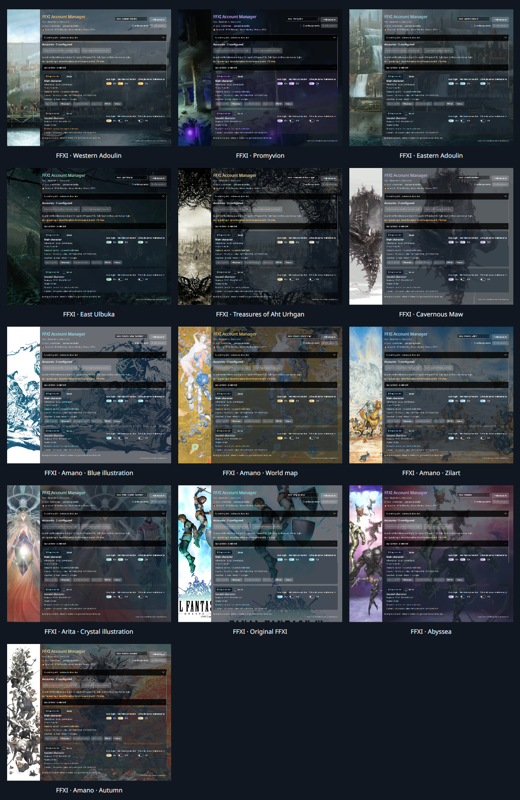
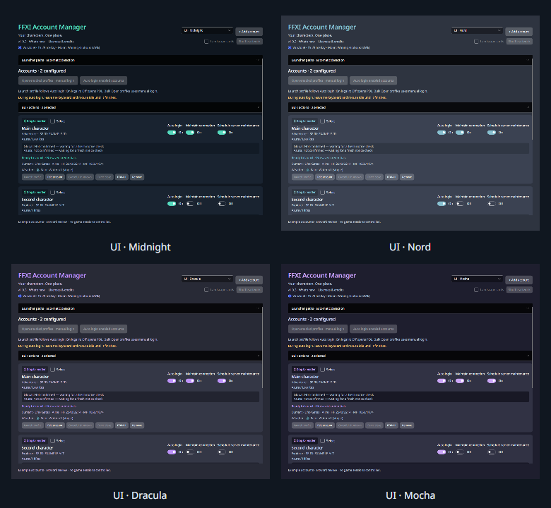

# Theme previews — v1.0.10

Actual application renders with example accounts. No real credentials or game sessions are used. Landscape cards are off to show the translucent surfaces. Expanded artwork views use aspect-preserving crops in the left panel and right background; Amano · Autumn pairs two distinct images.

## Artwork themes

[Landscape cards enabled: prominent artwork and distinct images](abyssea-landscape-cards.png). Shuffle uses the entire landscape pool before repeating.

## Dark UI themes

## Full-size examples

| Theme | Preview |
|---|---|
| UI · Midnight | [Full size](midnight.png) |
| UI · Nord | [Full size](nord.png) |
| UI · Dracula | [Full size](dracula.png) |
| UI · Mocha | [Full size](mocha.png) |
| FFXI · Western Adoulin | [Full size](adoulin.png) |
| FFXI · Promyvion | [Full size](rakaznar.png) |
| FFXI · Eastern Adoulin | [Full size](eastern-adoulin.png) |
| FFXI · East Ulbuka | [Full size](ulbuka.png) |
| FFXI · Treasures of Aht Urhgan | [Full size](amano-aht.png) |
| FFXI · Cavernous Maw | [Full size](maw.png) |
| FFXI · Amano · Blue illustration | [Full size](amano-blue.png) |
| FFXI · Amano · World map | [Full size](amano-map.png) |
| FFXI · Amano · Zilart | [Full size](amano-zilart.png) |
| FFXI · Arita · Crystal illustration | [Full size](arita-crystal.png) |
| FFXI · Original FFXI | [Full size](ffxi-original.png) |
| FFXI · Amano · Autumn | [Full size](amano-autumn.png) |
| FFXI · Abyssea | [Full size](abyssea.png) |

[Narrow-window Abyssea view](abyssea-narrow.png): the side panel hides to preserve room for controls.

FFXI artwork remains subject to the rights and credits in [the artwork notice](../../ARTWORK-NOTICE.md).
